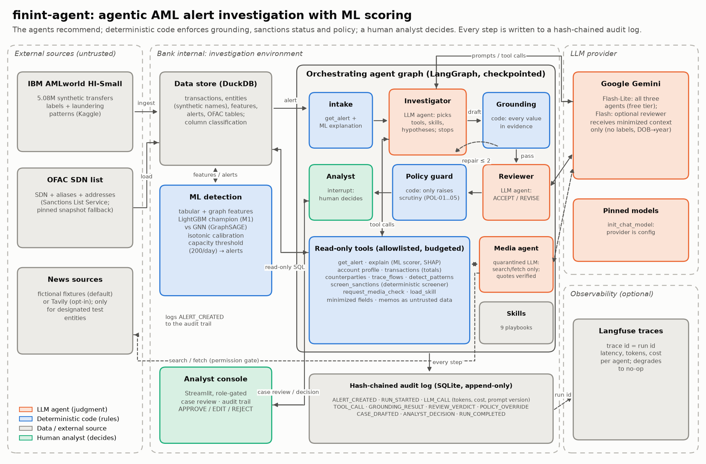

# finint-agent

**Agentic AML alert investigation with ML scoring.** A model scores transactions and raises
alerts sized to the analyst team's capacity. For a selected alert, a multi-agent system
gathers evidence with read-only tools, tests laundering typologies, screens parties against
the OFAC SDN list, checks adverse media and drafts a grounded case file with a recommended
disposition. **A human analyst always makes the final decision**, and every step lands in a
hash-chained audit log.



> Architecture diagram as PDF: [`docs/architecture.pdf`](docs/architecture.pdf).
> Data is fully synthetic (IBM AMLworld HI-Small); account holders, news and media entities are generated or fictional.

---

## Results at a glance

**Detection (test period, simulator's low-activity tail excluded; [ML report](reports/ml_report.md))**

| Model | Val PR-AUC | Test PR-AUC | Precision / recall at top 0.1% | at top 0.5% |
|---|---|---|---|---|
| M0 LightGBM, tabular | 0.491 | 0.412 | 47.5% / 42.2% | 13.1% / 58.2% |
| **M1 LightGBM, tabular + graph (champion)** | **0.552** | **0.419** | 48.4% / 43.0% | 13.4% / 59.7% |
| M2 GraphSAGE (PyTorch Geometric) | 0.321 | 0.255 | 32.5% / 28.9% | 13.2% / 58.4% |

- Recall per laundering typology at the top 0.5%: 82–92% for the 8 listed typologies (M1), 20% for laundering the patterns file does not list.
- **Analyst capacity 200 alerts/day → threshold 0.4545** on the calibrated score. On test, 56.5% of alerts contain laundering and they cover 33.4% of laundering transactions. Beyond ~200/day the marginal alert is mostly a false positive (36% → 14% precision for the next 50/day at 300/day).

**Investigation agent ([evaluation report](reports/eval_report.md))**

<!-- EVAL-TABLE -->

**Weekly operations report:** [`reports/ops_report_2026-W44.md`](reports/ops_report_2026-W44.md) (alert volume and change, precision of reviewed alerts, evidence-gathering time before/after, agent–analyst agreement, cost per alert, daily and monthly charts).

---

## How it works

### 1. Detection (spec 02)

| Step | Choice | Why |
|---|---|---|
| Split | chronological 60/20/20 **by transaction count** | the dataset's last 8 days are a 1.1k-row laundering tail; a day-based split would leave a degenerate test set ([ADR-02.6](.kiro/specs/02-ml-detection/design.md)) |
| Features | 26 tabular features in SQL with backward-only windows and `EXCLUDE TIES`; 24 graph features per sender/receiver from the **3 previous closed days** (degree, fan ratios, PageRank, 2/3/4-cycles, flow-through, multi-bank entity aggregates) | no future leakage, tested by recomputing features on data truncated at each transaction's time |
| Models | LightGBM baseline → + graph features → GraphSAGE edge classifier | the champion is picked by validation PR-AUC, not sophistication |
| Imbalance | class weights searched on validation (no resampling) | synthetic minority rows would corrupt graph features |
| Metrics | PR-AUC, precision/recall at 0.1/0.5/1% budgets, recall per typology | accuracy and ROC-AUC reward models that are useless at the top of the ranking |
| Calibration | isotonic on validation, stored as JSON breakpoints; reliability measured **out of sample** | on this data it did not improve test Brier, and the report says so |
| Threshold | the calibrated score that yields the analyst capacity per day | the binding constraint is analyst time, not a probability |
| Alerts | account-day alerts with features, SHAP top-5, contributing transactions, score, threshold and model version; one `ALERT_CREATED` audit event each | every alert is reproducible and explainable |

### 2. Investigation (spec 03)

```
intake → investigate ⇄ grounding → review ⇄ investigate → policy → analyst (interrupt) → finalize
```

| Node | Kind | What it decides |
|---|---|---|
| **Investigator** | LLM agent (Gemini Flash-Lite) | which tools to call, which skills (typology playbooks) to load, which hypotheses to test, when to stop |
| **Media agent** | LLM agent, quarantined | its queries, whether a news item is about the same entity, how to classify it; only search/fetch tools, never sees transactions |
| **Reviewer** | LLM agent (Gemini Flash-Lite; Flash optional) | accept, or send the draft back with concrete objections (max 2 rounds) |
| Grounding | code | every amount, date, account and name must exist in this run's tool outputs; 2 repair rounds, then the case is blocked |
| Policy guard | code | raises scrutiny only: a sanctions `MATCH` forces `ESCALATE`; unresolved potential matches, thin evidence, injection attempts and verified adverse media block a closure |
| Analyst | human, LangGraph `interrupt` | the final disposition; nothing is final without it |

Agency sits where the work is judgment; everything with compliance weight is plain, tested
Python in `src/finint/core/` (the constitution forbids framework imports there, and a test
enforces it).

### 3. Evaluation and reporting (spec 04)

76 alerts from the test period: natural alerts (laundering stratified by typology, plus
false positives) and *forced* alerts that carry injected test cases (12 prompt-injection
memos, sanctions near-matches and decoys, adverse-media entities). Ground truth is the
dataset label and the documented injections. Faithfulness is checked in code; injection
cases are run **paired** (with and without the payload). CI replays recorded Gemini
responses through the whole graph on a deterministic synthetic world, with no key.

---

## Guardrails and governance

| Concern | How it is handled | Where it is proven |
|---|---|---|
| **Human in the loop** | the graph stops at an `interrupt`; only an `AnalystDecision` (reason required for EDIT/REJECT) closes a case; tools are read-only | `tests/test_agents.py`, `tests/test_console.py` |
| **Faithfulness** | deterministic grounding validator over cited values *and* free text; repair loop; ungrounded cases are blocked, never shown as a recommendation | `tests/test_grounding.py` (rejection + property tests), eval report |
| **Sanctions false positives** | deterministic screener (rapidfuzz scores, DOB and country checks, thresholds in config); the LLM can only describe the status; the analyst sees scores and matched/mismatched fields | **24/24 injected cases correct** (17 true matches, 7 decoys) in `tests/test_screening.py` |
| **Tipping-off** | case files live only in the internal store and the role-gated console; there is no customer-facing surface; prompts forbid addressing the customer | `tests/test_console.py` |
| **Data minimization** | every column classified (`config/data_classification.yaml`); labels and ground truth are forbidden; DOB reaches the LLM as a year; unknown columns are dropped; the build fails on an unclassified column | `tests/test_core_guards.py`, `tests/test_classification.py` |
| **Prompt injection** | untrusted text (memos, names, news) wrapped as data; heuristic detector flags attempts as evidence; tool allowlist enforced by code; quarantined media agent; policy guard and grounding after every LLM step | 12/12 payloads detected, 0 benign memos flagged; paired eval |
| **Reputational risk** | media search only for designated test entities (permission gate); every claim needs a verbatim quote checked in code; categories (allegation ≠ charge ≠ conviction) | `tests/test_agents.py::test_media_agent_keeps_only_verbatim_quotes` |
| **Auditability** | append-only, hash-chained audit log: alerts, LLM calls (model, prompt hash, tokens, cost), tool calls, grounding, review, overrides, decisions; `make audit-verify`; optional Langfuse traces linked by run id | [`docs/audit.md`](docs/audit.md), `tests/test_audit.py` |

---

## Run it

Requirements: [uv](https://docs.astral.sh/uv/), Python 3.12, ~3 GB of disk for the data.

```bash
make install        # dev + data + ml + agent + ui dependency groups
make data           # download HI-Small (public Kaggle endpoint) + OFAC; build DuckDB (~45 s)
make train          # tabular + graph features, LightGBM M0 and M1
make alerts         # champion, calibration, capacity threshold, audited alerts
make report-ml      # reports/ml_report.md

cp .env.example .env   # add GOOGLE_API_KEY (Gemini)
uv run finint investigate AL-20220909-0001     # one alert, stops at the analyst decision
make app            # analyst console on http://localhost:8501

make eval-build     # eval/eval_set.jsonl
make eval           # agent evaluation (resumable)
make eval-report    # reports/eval_report.md
make report         # weekly operations report
make audit-verify   # recompute the audit hash chain
make check          # ruff, mypy, tests (what CI runs)
```

The GNN (optional): `uv sync --group gnn && uv run finint ml train --model m2`; its tests run with `make test-gnn`.
**Without an LLM key** the console still works: investigations degrade to a deterministic
evidence pack with `NEEDS_MORE_INFO`, and analysts can review and decide.

### Hosted demo (no install, no key)

The console has a **demo mode**: it builds the deterministic synthetic world on start-up
(~30 s) and replays recorded Gemini responses (`eval/cassettes/synthetic.json`), so a
reviewer can run real investigations, inspect evidence, sanctions scores and the audit trail,
and record decisions without installing anything or holding an API key. It switches on
automatically when no local database exists, or with `FININT_DEMO=1`.

Deploy on Streamlit Community Cloud: *New app* → this repository → main file
`src/finint/app/console.py` → Python 3.12 (dependencies: `src/finint/app/requirements.txt`).

<!-- DEMO-URL -->

---

## Engineering

- **Spec-driven development**: Kiro-style specs ([`.kiro/specs/`](.kiro/specs/)) with EARS requirements, ADRs and test strategies, governed by a Spec Kit [constitution](.specify/memory/constitution.md) and steering files.
- **Stack**: Python 3.12, uv, DuckDB, LightGBM, igraph, PyTorch Geometric, LangGraph, Gemini via `init_chat_model`, Streamlit, Langfuse (optional).
- **Quality gates in CI**: ruff (incl. bandit security rules), mypy (strict on the compliance core), 340+ tests, the replayed agent evaluation, and `pip-audit` on dependencies.
- **Reproducibility**: seeded data generation and injections, versioned prompts (hashes in the audit log), model versions with git SHA, pinned LLM model ids.

```
src/finint/
  core/      compliance rules: grounding, screening, policy, minimization, injection, audit
  data/      ingestion, normalization, synthetic identities, OFAC, injections, quality report
  ml/        features, graph features, LightGBM, GNN, calibration, threshold, alerts, reports
  tools/     read-only investigation tools, sanctions tool, media providers, skills loader
  agents/    LLM factory, investigator, media agent, reviewer, LangGraph graph
  app/       role-gated services and the Streamlit analyst console
  eval/      eval set, runner, metrics, replay, weekly operations report
skills/      9 investigation playbooks (Agent Skills format)
prompts/     versioned prompts
data/injections, data/fixtures   documented test cases and fictional media
```

## Data and responsible use

- **IBM AMLworld HI-Small** (CDLA-Sharing 1.0): synthetic transactions; names are generated with Faker.
- **OFAC SDN list**: public U.S. Treasury data; a pinned snapshot keeps builds reproducible.
- **Injected sanctions cases** use real SDN entries only to test screening; no real person is linked to any transaction.
- **Adverse media** fixtures are fictional, on the reserved `news.example` domain. Live search is opt-in and only for designated test entities.
- **LLM**: the PoC runs on the Gemini free tier with synthetic data only. A real deployment would use a paid tier or Vertex AI (no training on prompts) or a self-hosted model; the model factory is provider-agnostic.

## Limitations and next steps

- About ten active days of data: longer histories in the operations report are simulated and labelled.
- The GNN was time-boxed and underperforms gradient boosting at the top of the ranking.
- Laundering transactions without a listed typology are the main detection gap.
- The analyst in the evaluation is simulated from labels; real analyst disagreement is not modelled.
- Next: same-day graph features, a recalibration job for prior shift, SSO for the console, and a richer adverse-media source behind the same permission gate.

## License

MIT (code). Dataset under its own license (CDLA-Sharing 1.0).
