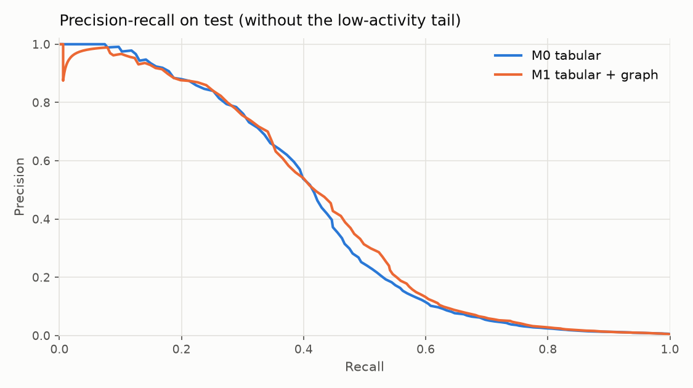
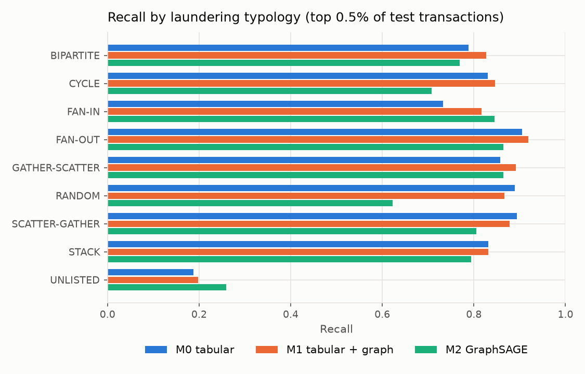
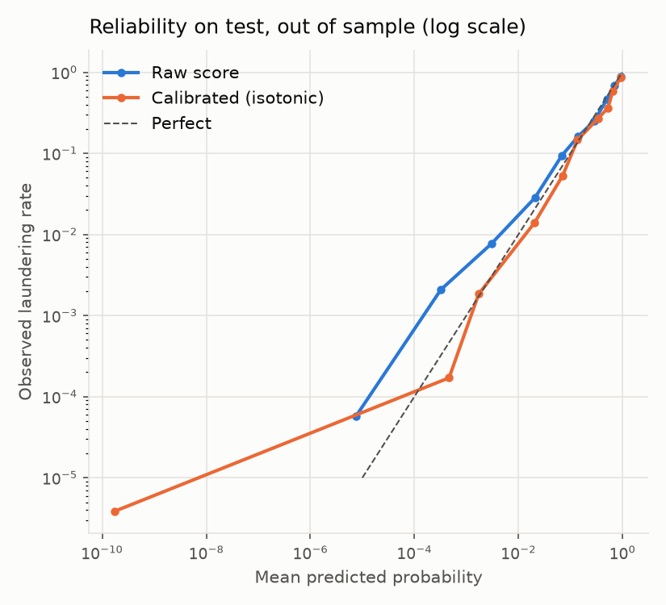
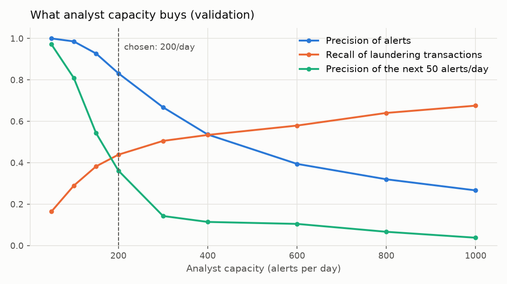

# ML detection report

Generated by `make report-ml` from the saved artifacts of `make train` and `make alerts`. Data: IBM AMLworld HI-Small (synthetic), chronological 60/20/20 split by transaction count. **Primary test metrics exclude the simulator's low-activity tail** (Sep 11-18: 1,108 transactions, 59% laundering), which would otherwise inflate them (ADR-02.7); full-test PR-AUC is shown for transparency.

## Model comparison

| Model | Version | Val PR-AUC | Test PR-AUC | Full test | P / R @0.1% | P / R @0.5% | P / R @1% |
|---|---|---|---|---|---|---|---|
| M0 tabular | `m0-7b8e9fe-20261113` | 0.491 | **0.412** | 0.546 | 47.5% / 42.2% | 13.1% / 58.2% | 7.4% / 66.0% |
| M1 tabular + graph | `m1-81181ae-20261113` | 0.552 | **0.419** | 0.609 | 48.4% / 43.0% | 13.4% / 59.7% | 7.5% / 67.0% |
| M2 GraphSAGE | `m2-39005b1-20261113` | 0.321 | **0.255** | 0.448 | 32.5% / 28.9% | 13.2% / 58.4% | 7.6% / 67.6% |

**Champion: M1 tabular + graph**: highest validation PR-AUC (m1 0.552, m0 0.491, m2 0.321).

## Precision-recall curves

Curve not stored for: m2 (trained before curves were saved in metrics.json); its PR-AUC above is exact.

## Recall by typology

At the top 0.5% of test transactions. `UNLISTED` = laundering transactions the patterns file does not list (38% of all positives): they have no typology, and every model finds them far less often.

| Typology | M0 tabular | M1 tabular + graph | M2 GraphSAGE |
|---|---|---|---|
| BIPARTITE | 78.8% (n=52) | 82.7% (n=52) | 76.9% (n=52) |
| CYCLE | 83.1% (n=65) | 84.6% (n=65) | 70.8% (n=65) |
| FAN-IN | 73.2% (n=71) | 81.7% (n=71) | 84.5% (n=71) |
| FAN-OUT | 90.5% (n=74) | 91.9% (n=74) | 86.5% (n=74) |
| GATHER-SCATTER | 85.7% (n=147) | 89.1% (n=147) | 86.4% (n=147) |
| RANDOM | 88.9% (n=45) | 86.7% (n=45) | 62.2% (n=45) |
| SCATTER-GATHER | 89.4% (n=123) | 87.8% (n=123) | 80.5% (n=123) |
| STACK | 83.2% (n=107) | 83.2% (n=107) | 79.4% (n=107) |
| UNLISTED | 18.7% (n=459) | 19.8% (n=459) | 25.9% (n=459) |

## Calibration

Isotonic regression fitted on validation scores (stored as JSON breakpoints, not a pickle) and checked **out of sample on test**: Brier score 0.000804 → 0.000813. **Calibration does not improve Brier out of sample**: the isotonic fit follows validation too closely. Ranking and the capacity threshold are unaffected (both monotone), but calibrated scores should be read as approximate probabilities.

## Alert threshold from analyst capacity

Alerts are **account-days** (one sending account on one day, scored by its riskiest transaction), because a laundering pattern spans many transactions and analysts work cases, not rows (ADR-02.1). The threshold is the calibrated score at which validation produces the team's daily capacity (ADR-02.3).

| Capacity/day | Threshold | Precision | Recall (txns) | Next 50/day precision |
|---|---|---|---|---|
| 50 | 0.9800 | 100.0% | 16.5% | 97.1% |
| 100 | 0.9115 | 98.6% | 28.9% | 81.0% |
| 150 | 0.6316 | 92.7% | 38.3% | 54.3% |
| 200 | 0.4545 | 83.2% | 43.9% | 36.2% |
| 300 | 0.1923 | 66.8% | 50.6% | 14.3% |
| 400 | 0.1228 | 53.6% | 53.4% | 11.4% |
| 600 | 0.0902 | 39.4% | 57.9% | 10.5% |
| 800 | 0.0725 | 32.0% | 64.0% | 6.7% |
| 1000 | 0.0597 | 26.7% | 67.6% | 3.8% |

**Chosen: 200 alerts/day → threshold 0.4545.** Up to this point the next 50 alerts a day would still be laundering 36.2% of the time; at 300/day that marginal precision is 14.3%, so extra capacity there mostly buys false positives.

### Alerts produced

1,061 alerts over the validation and test periods (validation: 562, test: 499). On **test**, 56.5% of alerts contain laundering and they cover 33.4% of laundering transactions. Validation figures are optimistic because calibration and threshold were fitted on validation; the test figures are the honest estimate.

Every alert is stored with its features, SHAP top-5 contributions, contributing transactions, score, threshold and model version, and is logged as an `ALERT_CREATED` event in the hash-chained audit trail.

## Findings

- **Graph features help, modestly.** M1 beats M0 on validation PR-AUC and lifts recall on fan-in and bipartite patterns, but the test gain is small. Graph features only see closed previous days (the leakage-safe choice), while many attempts unfold within a day.

- **The GNN did not beat gradient boosting** within its time box (validation PR-AUC 0.321 vs 0.552). It is reported, not chosen: the champion is picked by metrics, not sophistication (ADR-02.2).

- **The biggest gap is `UNLISTED` laundering** (about 20% recall vs 75-90% for listed typologies). These transactions are labelled but follow no listed pattern.

- **Class weights did not help.** `scale_pos_weight` = 1 beat 10 and 50 on validation PR-AUC for every LightGBM model.
