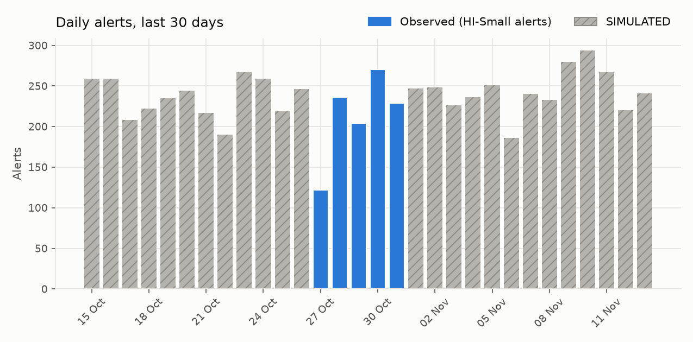
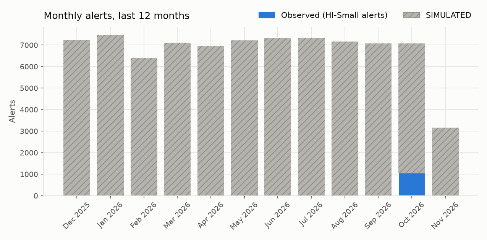

# FinCrime operations report: week 2026-W44

Generated by `make report` on 2026-11-13. Alert dates are the dataset's timestamps shifted to the present (weekday-preserving). **Observed** figures come from the model's alerts and the audit trail; **SIMULATED** figures fill history the dataset does not have.

## Key metrics

| Metric | Value | Basis |
|---|---|---|
| Alerts this week | 1,554 | 1,061 observed + 493 SIMULATED (days without data) |
| Change vs previous week | -5% | previous week SIMULATED |
| Precision of reviewed alerts (confirmed laundering) | 67% of 1,061 | observed (dataset labels as analyst outcome) |
| Evidence-gathering time per alert: before | 40 min | ASSUMPTION (config/ops.yaml) |
| Evidence-gathering time per alert: after (agent) | 6.2 min mean, 0.2 min median | observed over 136 investigations; the mean includes runs that waited on rate limits or a sleeping machine |
| Agent-analyst disposition agreement | 38% | observed over 136 decisions (simulated analyst = ground truth) |
| Cost per investigated alert | $0.0152 | observed, list prices (free tier in this PoC) |

## Daily alerts, last 30 days

## Monthly alerts, last 12 months

## Cost per investigated alert, by day

| Day | Mean cost | Investigations |
|---|---|---|
| 2026-11-14 | $0.0152 | 136 |

## Notes

- Volume counts model alerts only (forced evaluation alerts are excluded).
- The 'before' time is an assumption, not a measurement; the 'after' time is the agent's evidence-gathering time and excludes the analyst's review.
- Precision uses dataset labels as the reviewed outcome. Agreement uses the evaluation's simulated analyst, who follows the label.
